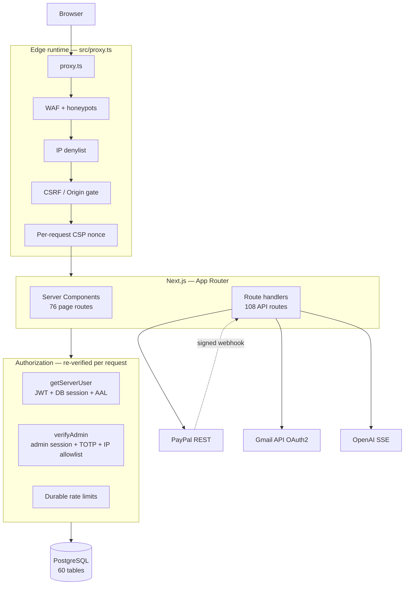

# StrataLanding

A full-stack web platform for running a productised design studio end to end — client
accounts, project briefs, proposals, threaded messaging, file delivery, and split
deposit/balance payments — built with Next.js 16, React 19, TypeScript and PostgreSQL.

> **This repository is a sanitized public portfolio snapshot of the StrataLanding
> production platform. Private operational data, development history,
> customer/prospect data, credentials, and internal tooling are intentionally
> excluded.**

---

## Overview

StrataLanding is not a marketing site with a contact form. It is the operational
backbone of a service business: the system a customer signs into after they buy, and
the system the operator runs the business from.

A visitor submits a project brief or a quote request. That creates a client record and
a project, which then moves through a defined lifecycle — `new` → `proposal_sent` →
`deposit_paid` → `in_production` → `ready_for_final_payment` → `paid_in_full` →
`launched`. Each transition is gated server-side, triggers transactional email, and is
visible to the client in their portal. An AI onboarding assistant interviews the client
to expand a thin brief into a usable specification, and a project-scoped chat assistant
answers questions against that project's own brief and proposals.

Payment is split into a deposit and a balance. Both run through PayPal's REST API with
the amount derived on the server — never accepted from the client — and recorded through
a database uniqueness constraint that makes capture idempotent under refresh,
double-click, multiple tabs and replayed webhooks. Refunds, reversals and disputes are
handled by the same webhook, which reverts project status and claws back any affiliate
commission already credited.

Around all of this sits a security layer that is a substantial part of the engineering:
an edge WAF, durable rate limiting backed by Postgres rather than process memory,
JWT-based session authentication with server-side session validation and TOTP MFA, and a
hash-chained audit log designed so that tampering is detectable after the fact.

---

## Key Features

**Client portal** — authenticated dashboard with project status, milestones, an amount-due
breakdown, file uploads, revision tracking, threaded messaging, and account/security
settings including MFA enrolment.

**Authentication & authorization** — email/password and magic-link sign-in, email
verification, password reset, TOTP multi-factor with step-up enforcement, progressive
account lockout, and full session revocation. Client and admin authentication are
separate systems with separate cookies and lifetimes.

**Admin console** — 41 admin API routes and 22 admin pages covering clients, projects,
proposals, milestones, payments, refunds, price overrides, uploads, affiliates, banned
emails, and a security command centre.

**Proposals** — generated from a brief, delivered by email on a schedule, accepted via a
signed token link, and convertible directly into a paid project.

**Payments (PayPal)** — order creation, idempotent capture, signature-verified webhooks,
50/50 deposit/balance split, server-authoritative pricing with admin override support,
and refund/chargeback handling.

**AI assistant** — a streaming (SSE) project assistant scoped strictly to the signed-in
client's own project, with escalation-to-human detection, message classification, daily
usage limits, and an automated onboarding interview.

**Transactional email** — Gmail API over OAuth2 with in-process token caching, multipart
HTML/plaintext messages, header-injection protection, a durable failure log, and a
distinct "critical" sender that throws rather than silently dropping a message the user
was told to expect.

**Affiliate/referral system** — referral links, click tracking, conversion recording, and
per-project commission credited exactly once by unique constraint.

**Outreach subsystem** — campaign management with send queues, per-domain rate limits,
IMAP reply polling, bounce parsing, reply matching, and suppression handling.

**Security controls** — edge WAF, IP denylist, CSRF enforcement, per-request CSP nonces,
durable rate limiting, tamper-evident audit log, and CI-enforced secret scanning.

**Analytics** — first-touch attribution that survives the full buying cycle, a
self-hosted event beacon, and funnel/revenue reporting.

---

## Tech Stack

| Layer | Technology |
|---|---|
| Framework | Next.js 16.3 (App Router, React Server Components, Turbopack) |
| UI | React 19.2, TypeScript 5.9 (`strict`), Tailwind CSS 4.1, Framer Motion 12 |
| Database | PostgreSQL via [postgres.js](https://github.com/porsager/postgres) 3.4 |
| Auth | `jose` (JWT, HS256) · `bcryptjs` (cost 12) · `otpauth` (TOTP) · Node `crypto` (AES-256-GCM) |
| Payments | PayPal REST API v2 (direct `fetch`, no SDK) |
| Email | Gmail REST API over OAuth2 · `nodemailer` (SMTP) · `imapflow` (reply polling) |
| AI | OpenAI SDK, streamed over Server-Sent Events |
| Testing | Vitest 3.2 |
| CI | GitHub Actions — CodeQL (`security-extended`), `npm audit`, Gitleaks |
| Hosting | Netlify (`@netlify/plugin-nextjs`) |

---

## Architecture

Requests enter through an edge proxy that runs before any route handler. It applies the
WAF, the IP denylist and CSRF origin checks, and stamps a per-request CSP nonce. Only
then does a request reach a route handler, where authentication and authorization are
re-verified against the database — the edge check is deliberately treated as a
pre-filter, never as the gate, because the edge runtime cannot reach Postgres.



**Server/client boundary.** Data loading and every authorization decision happen in
Server Components and route handlers. Client Components are used only where interaction
demands it, and the marketing chrome sits behind a dynamic-import boundary so
authenticated shells don't ship unused JavaScript.

**Database access.** A single lazily-initialized `postgres.js` client, wrapped in a
`Proxy` so it is constructed on first use rather than at import time — which is what lets
the application build and prerender without a live database connection. All SQL uses
tagged templates, so values are parameterized by construction.

---

## Engineering Highlights

### Idempotent payment capture

Taking the same payment twice is the failure that actually costs money, so capture is
idempotent at three layers. `capturePayPalOrderIdempotent()` catches PayPal's
`ORDER_ALREADY_CAPTURED` 422 and re-reads the order instead of erroring. The database
carries a partial unique index on `paypal_capture_id`, and the insert is
`ON CONFLICT … DO NOTHING RETURNING id` — the returned row is the exactly-once gate, so
side effects (status advance, commission, confirmation email) fire only for the
transaction that actually won the insert. If anything fails *after* money moved, the
route returns `500 { capturedButNotRecorded: true }` rather than a misleading 200.

The charged amount is never taken from the client. `amountDueCents()` recomputes it
server-side and is called by both order creation and capture validation, and the captured
currency is checked explicitly.

`src/lib/paypal.ts` · `src/lib/project-payment.ts` · `src/app/api/paypal/capture-order/route.ts`

### Sessions that don't trust their own token

The session JWT is signed HS256 with a pinned algorithm and carries a session id, but it
is not the source of truth. `getServerUser()` re-reads the session row on every request
and takes the authentication assurance level (`aal1`/`aal2`) from the **database**, not
the token. Two consequences follow: revoking a session takes effect immediately rather
than at token expiry, and a token minted before MFA enrolment cannot be replayed to skip
the step-up gate. TOTP secrets are encrypted at rest with a per-record scrypt salt and
AES-256-GCM, and replay is blocked by recording the last accepted time step.

`src/lib/auth/` · `src/lib/auth-server.ts`

### Structural CSRF rather than per-route patches

CSRF protection is enforced centrally in the edge proxy: any cross-origin state-changing
request to `/api/**` is rejected before reaching a handler. A per-route wrapper is
something a future route can forget; a central gate is not. Endpoints that legitimately
receive cross-site requests are exempted explicitly and each authenticates by another
means — PayPal by webhook signature, cron by bearer secret, internal logging by HMAC. A
verification script asserts that no cookie-authenticated mutating route is left
unprotected, and it runs in CI.

`src/proxy.ts` · `src/lib/security/with-protection.ts` · `scripts/csrf-matrix.cjs`

### Rate limiting that survives serverless

In-memory counters are meaningless when every concurrent instance has its own memory. The
authoritative limiter is a Postgres row updated by a single atomic
`INSERT … ON CONFLICT DO UPDATE` that reset-or-increments within one statement, so the row
lock prevents concurrent requests racing past the cap. An in-memory L1 fast-reject sits in
front to bound database writes under a flood, which is sound because a local count is
always a lower bound on the global one. Authentication paths use a variant that degrades
to the in-memory limiter rather than failing open, and identity-keyed limits (per email)
sit alongside IP limits so rotating IPs doesn't defeat them.

`src/lib/security/rate-limit-durable.ts`

### Tamper-evident audit log

Security events are hash-chained: each row stores
`sha256(event | user | ip | user-agent | severity | previous_hash)`. Writes happen inside a
transaction holding an advisory lock so concurrent inserts cannot fork the chain, and
`verifyAuditChain()` detects both edited content and deleted or reordered rows. An
attacker who reaches the database can still delete rows — but not silently.

`src/lib/security/audit-log.ts`

### Operating-cost engineering

The database is a scale-to-zero serverless Postgres, billed by compute time. It was
staying awake continuously at zero human visitors because the WAF wrote an audit row for
every bot probe, and probes arrived more frequently than the idle timeout. Database
persistence for WAF verdicts became opt-in behind an environment flag, and the analytics
beacon gained both positive and negative in-process caches so unauthenticated traffic
can't wake the database. Connection pooling was likewise resized from 10 to 3 per
instance — correct for one long-lived server, wrong for N concurrent lambdas racing the
provider's connection ceiling exactly during a traffic spike.

---

## Screenshots

Add 3–5 images to `docs/screenshots/` and reference them here.

| | |
|---|---|
| **Homepage** |  |
| **Client portal** |  |
| **Proposal & checkout** |  |
| **Admin console** |  |
| **Security centre** |  |

> Screenshots must be captured against local seed data only — never production.

---

## Running Locally

**Requirements:** Node.js 22+, PostgreSQL 14+.

```bash
# 1. Install dependencies
npm ci

# 2. Create your environment file
cp .env.example .env.local
#    Then fill in the values. At minimum you need DATABASE_URL and AUTH_SECRET.
#    Generate secrets with:  openssl rand -hex 32

# 3. Create the schema
psql "$DATABASE_URL" -f migrations/000-baseline.sql
#    Then apply the numbered migrations above 000 in filename order.

# 4. Run
npm run dev            # http://localhost:3000
```

**Verification:**

```bash
npm test               # Vitest
npx tsc --noEmit       # TypeScript
npm run lint           # ESLint
npm run build          # production build
npm run verify:csrf    # assert no unprotected cookie-auth mutation
npm run verify:csp     # assert nonce-scoped routes are not static
npm run verify:payments# assert payment idempotency indexes exist
```

The application builds without a database connection — the Postgres client is
lazily initialized. Tests that require a live database skip automatically when
`DATABASE_URL` is unset.

**Never commit real credentials.** `.env*` is gitignored except `.env.example`, and a
Gitleaks scan runs in CI on every push.

---

## Project Structure

```
src/
  app/              Next.js App Router
    api/            108 route handlers (auth, admin, paypal, portal, cron, …)
    admin/          admin console (23 pages)
    portal/         authenticated client portal (15 pages)
    proxy.ts        → see src/proxy.ts: edge WAF, CSRF gate, CSP nonce
  components/       130 React components, incl. the ui/ design system
  lib/
    auth/           sessions, tokens, password hashing, TOTP
    security/       WAF, durable rate limiting, audit log, sanitizers, env validation
    outreach/       campaign sending, IMAP polling, bounce/reply parsing
    paypal.ts       PayPal REST integration
    db.ts           lazily-initialized Postgres client
migrations/         25 SQL migrations (000-baseline.sql defines 60 tables)
tests/              Vitest suites — payments, CSRF, uploads, sessions, attribution
scripts/security/   WAF self-test, secret pre-commit hook, incident response CLI
.github/workflows/  CodeQL, npm audit, Gitleaks
```

---

## Status

This is a **sanitized public snapshot** of a production codebase, published as portfolio
evidence. It is not the live deployment and is not intended to be run as a
production service.

Relative to the private repository, the following are deliberately excluded: development
history, business and customer data, prospect records, outreach content, internal audit
and operations documents, deployment automation, and local tooling configuration. The
demo-gallery route group has been reduced from its full set to **5 representative
routes**, so this repository reads as the application it is rather than a page gallery.
The published case study covers the one client build this studio can substantiate; no
performance, conversion or revenue figures are claimed anywhere, because none have been
measured.

Everything described above is present and verifiable in this repository. Known gaps,
stated plainly: migrations are applied manually (there is no migration runner), request
validation is hand-written rather than schema-driven, uploaded files are stored as
`BYTEA` in Postgres rather than in object storage, and CI runs security analysis but not
the build or test suite.
